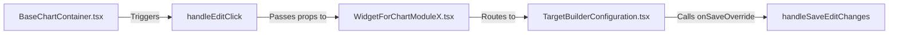

# Chart Edit Feature (Existing Charts) Guide

This guide provides instructions for other agents or developers to extend the widget **Edit** feature to other chart types (e.g., Pie, Line, Area, Gauges, etc.) across the application.

---

## 1. Flow Overview

When an existing chart is edited, the system loads the preview on the left and the configuration panel on the right side-by-side inside `BaseChartContainer.tsx` in real-time.



---

## 2. Steps to Extend to Other Chart Types

### Step 1: Enable the Category in `BaseChartContainer.tsx`
Locate the `onEdit` callback inside the `menuActions` prop in `BaseChartContainer.tsx` and append the new category keys:
```tsx
onEdit:
  !isCreationMode &&
  tierLevel === 0 &&
  (category === "BAR" || category === "SAMPLECHART" || category === "PIE" || category === "LINE")
    ? () => handleEditClick()
    : undefined,
```

### Step 2: Update the Configuration Selector (Module Wrapper)
Identify which Module selector wrapper wraps the chart:
- **Module One**: `BAR`, `SAMPLECHART` (`WidgetForChartModuleOne.tsx`).
- **Module Two**: `PIE`, `RAG`, etc. (`WidgetForChartModuleTwo.tsx`).
- **Module Three**: (`WidgetForChartModuleThree.tsx`).

Add `onSaveOverride?: (payload: any) => void;` to the prop type definitions and destructure/forward it:
```tsx
const WidgetForChartModuleTwo = ({
  // ... other props
  onClose,
  onSaveOverride,
}: {
  // ... other types
  onClose?: () => void;
  onSaveOverride?: (payload: any) => void;
}) => {
  return (
    <PieChartConfiguration {...props} onSaveOverride={onSaveOverride} />
  );
};
```

### Step 3: Implement Interception in Configuration Component
In the configuration component (e.g., `PieChartConfiguration.tsx`), accept `onSaveOverride` and intercept the save logic in `handleSaveChanges`:
```tsx
const handleSaveChanges = async () => {
  const payload = {
    // ... payload construction ...
  };

  if (onSaveOverride) {
    toast.dismiss(toastId);
    onSaveOverride(payload);
    return;
  }

  // ... standard creation mutation logic ...
};
```

### Step 4: Redux Orchestration (`activeConfigWidgetId`)
To ensure that editing a chart behaves exactly like chart creation, you **must** coordinate the active edit widget with the dashboard layout orchestrator via Redux.
Add a `useEffect` inside `BaseChartContainer.tsx` that dispatches the chart ID when editing starts:
```tsx
useEffect(() => {
  if (isEditing && chartId) {
    dispatch(setActiveConfigWidgetId(chartId));
  } else if (!isEditing) {
    dispatch(setActiveConfigWidgetId(null));
  }
  return () => {
    if (isEditing) {
      dispatch(setActiveConfigWidgetId(null));
    }
  };
}, [isEditing, chartId, dispatch]);
```
This enables the dashboard orchestrator (`ProjectDashboardView.tsx`) to expand the grid item containing the chart to 20 columns and track/resize its height dynamically.

### Step 5: Layout & Sizing Rules (Sticky, Scroll & Revert)
When `isEditing` is true, the system renders the preview and config panels side-by-side:
1. **Flex Wrapper Align Start**: The flex container in `BaseChartContainer.tsx` must use `items-start` (`className="flex gap-3 h-full w-full min-h-0 items-start"`) so that the configuration panel can expand to its natural height instead of stretching to match a fixed height.
2. **Fixed Height & Sticky**: The chart preview wrapper gets a fixed height and sticky positioning (`className="flex-1 min-w-0 h-[450px] sticky top-[-5px] z-10"`).
3. **Reversion Safety Check**: To prevent trailing height measurements (from the `MutationObserver` on unmount or layout updates) from overwriting the reverted layout back to its expanded height, check `prev[activeConfigId].w === 20` inside the observer's state updates:
   ```typescript
   setLayouts((prev: any) => {
     // Safely bail out if the widget is no longer active/expanded (w !== 20)
     if (!prev[activeConfigId] || prev[activeConfigId].w !== 20) return prev;
     if (prev[activeConfigId]?.h === measuredH) return prev;
     return { ...prev, [activeConfigId]: { w: 20, h: measuredH } };
   });
   ```
4. **Layout Fallbacks**: Ensure layout reverting in `ProjectDashboardView.tsx` reverts to the backed-up layout or defaults to the correct category height (e.g. `18` for Horizontal/Stacked Bar charts) if the backup is somehow lost.
5. **Popover Styling**: The "Edit" menu action inside `ChartCardWrapper.tsx` must use the `text-blue-500` class to visually highlight it.

